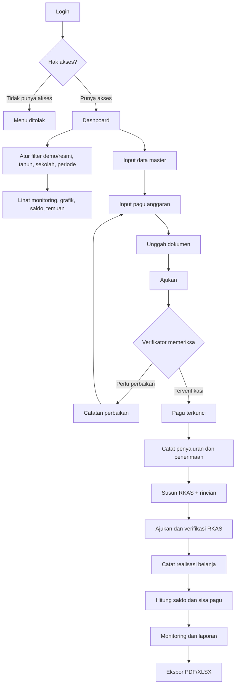
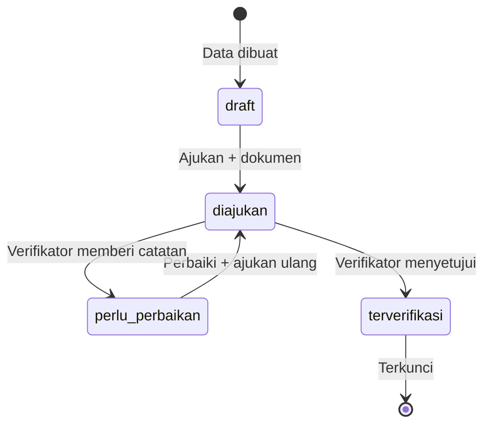

# Audit Alur Sistem Monitoring BOS SMP

Dokumen ini menjelaskan cara kerja aplikasi dengan bahasa operasional. Aplikasi adalah sistem monitoring internal untuk mencatat, memeriksa, dan merangkum data BOS; aplikasi tidak menggantikan ARKAS/MARKAS atau pengesahan resmi dinas.

## 1. Ringkasan hasil audit

| Area | Hasil audit |
|---|---|
| Login dan hak akses | Menggunakan Filament + Spatie Permission. Lima role tersedia dan menu dibatasi berdasarkan permission. |
| Data master | Kecamatan, sekolah, tahun anggaran, jenis BOS, komponen belanja, dan tahap penyaluran menjadi referensi sebelum transaksi. |
| Alur keuangan | Pagu → penyaluran/penerimaan → RKAS → realisasi → saldo/laporan. Data keuangan memakai status draft, diajukan, terverifikasi, atau perlu perbaikan. |
| Verifikasi | Penginput tidak dapat memverifikasi datanya sendiri. Pengajuan wajib memiliki dokumen pendukung. |
| Penguncian | Data diajukan/terverifikasi tidak dapat diedit biasa. Koreksi dilakukan dengan transaksi pembalik yang tertaut dan terdokumentasi. |
| Monitoring | Dashboard hanya menjumlahkan data terverifikasi dan menyediakan filter periode, sekolah, kecamatan, jenis BOS, tahap, serta lingkup demo/resmi. |
| Keamanan dokumen | Dokumen disimpan privat dan diunduh melalui route terautentikasi/policy. Audit log mencatat login, perubahan, verifikasi, dan ekspor. |
| Data demo | Data simulasi diberi label `[DEMO]`, jenis `DEMO-BOS`, dan flag `is_demo`; dapat dipisahkan dari data resmi. |

## 2. Flowchart besar sistem



## 3. Alur kerja yang mudah diikuti

### Tahap A — Persiapan referensi

Super Admin mengisi atau memeriksa Kecamatan, Data Sekolah, Tahun Anggaran, Jenis BOS, Komponen Belanja, dan Tahap Penyaluran. Referensi ini dipakai sebagai pilihan pada formulir berikutnya. Tahun anggaran dapat dikunci setelah periode selesai; data keuangan pada tahun terkunci tidak boleh berubah.

### Tahap B — Menetapkan pagu

1. Operator membuat Pagu Anggaran untuk kombinasi sekolah, tahun, dan jenis BOS.
2. Operator mengunggah SK/berkas sumber.
3. Operator memilih **Ajukan**.
4. Verifikator memeriksa nominal, sekolah, tahun, sumber, dan dokumen.
5. Verifikator memilih **Verifikasi** atau **Minta Perbaikan**.
6. Jika perlu perbaikan, operator memperbaiki catatan lalu mengajukan ulang.

Pagu yang sudah terverifikasi menjadi dasar semua data keuangan turunannya.

### Tahap C — Penyaluran dan penerimaan

Penyaluran adalah dana yang dikirim/ditetapkan pada tahap tertentu. Penerimaan adalah dana yang benar-benar diterima sekolah. Keduanya dicatat terpisah karena nilainya dapat berbeda. Penerimaan dapat ditautkan ke penyaluran jika referensinya sudah diketahui.

### Tahap D — RKAS

1. Operator membuat header RKAS dan menentukan versi.
2. Operator menambahkan Rincian RKAS per komponen belanja.
3. RKAS wajib memiliki minimal satu rincian dan dokumen sebelum diajukan.
4. Setelah terverifikasi, RKAS dan rinciannya terkunci.
5. Perubahan anggaran dibuat sebagai versi RKAS baru, bukan mengubah versi lama.

### Tahap E — Realisasi belanja

Realisasi harus menunjuk Rincian RKAS yang sudah terverifikasi. Mode **transaksi** memakai satu tanggal; mode **rekap** memakai rentang periode. Sistem menolak periode yang bertumpang tindih untuk komponen yang sama agar belanja tidak dihitung dua kali.

### Tahap F — Saldo dan monitoring

Rumus utama sistem:

```text
Saldo terhitung = Saldo awal + Penerimaan - Realisasi + Penyesuaian saldo
Sisa pagu       = Pagu berlaku - Penerimaan kumulatif
Persen realisasi = Realisasi / Total RKAS terverifikasi × 100%
```

Saldo dilaporkan dari sekolah dibandingkan dengan saldo terhitung pada tanggal laporan yang sama. Selisih ditampilkan sebagai temuan untuk ditindaklanjuti, bukan langsung dianggap pelanggaran.

## 4. Status data keuangan



- `draft`: masih boleh dilengkapi oleh penginput.
- `diajukan`: menunggu pemeriksaan; tidak boleh diedit biasa.
- `perlu_perbaikan`: kembali ke penginput dengan catatan.
- `terverifikasi`: masuk ke dashboard, saldo, dan laporan; terkunci.

## 5. Perubahan pagu dan koreksi transaksi

Pagu terverifikasi tidak diedit langsung. Gunakan **Perubahan Pagu** yang menyimpan nilai lama, nilai baru, alasan, tanggal, dan dokumen. Sistem memeriksa bahwa nilai lama masih sama sebelum perubahan disetujui.

Penyaluran, penerimaan, dan realisasi terverifikasi juga tidak dihapus. Untuk membatalkan transaksi, buat transaksi koreksi dengan nominal negatif yang tepat sama dengan transaksi asli, tautkan ke transaksi asli, lalu ajukan dan verifikasi. Riwayat transaksi lama tetap tersimpan.

## 6. Pembagian tugas pengguna

| Role | Tugas utama |
|---|---|
| Super Admin | Mengelola pengguna, role, referensi, dan seluruh data. |
| Operator BOS | Menginput data, mengunggah bukti, mengajukan, memperbaiki, dan mengimpor data. |
| Verifikator | Memeriksa dokumen dan data; menyetujui atau meminta perbaikan. Tidak dapat memverifikasi data yang dibuat sendiri. |
| Kepala Bidang SMP | Membaca monitoring dan menambahkan evaluasi/tindak lanjut. |
| Pimpinan Dinas | Membaca data terverifikasi dan laporan. Data draft/pengajuan tidak ditampilkan sebagai data resmi. |

## 7. Alur penggunaan harian

1. Login.
2. Pilih **Lingkup Data**: `Data resmi saja` saat rapat/laporan resmi; `Data demo saja` untuk latihan.
3. Pilih tahun, sekolah/kecamatan, dan periode.
4. Periksa kartu Pagu, Penerimaan, Realisasi, Saldo, dan Temuan.
5. Buka temuan untuk melihat sekolah atau transaksi yang perlu diperiksa.
6. Verifikator memproses antrean pengajuan.
7. Cetak atau ekspor laporan setelah filter sesuai.

## 8. Catatan audit dan batasan operasional

- Data demo adalah simulasi dan tidak boleh dipakai sebagai angka laporan resmi.
- Status terverifikasi di data demo hanya mensimulasikan alur pemeriksaan.
- Pengesahan laporan oleh Kepala Bidang belum diaktifkan karena membutuhkan kebijakan tertulis instansi.
- Daftar komponen, tahapan, jadwal, sumber penetapan, dan klasifikasi BOS harus dikonfirmasi dengan dokumen resmi sebelum produksi.
- Sebelum go-live, lakukan backup database, buat akun operator/verifikator terpisah, ganti password admin, dan uji satu siklus data resmi dari pagu sampai laporan.

